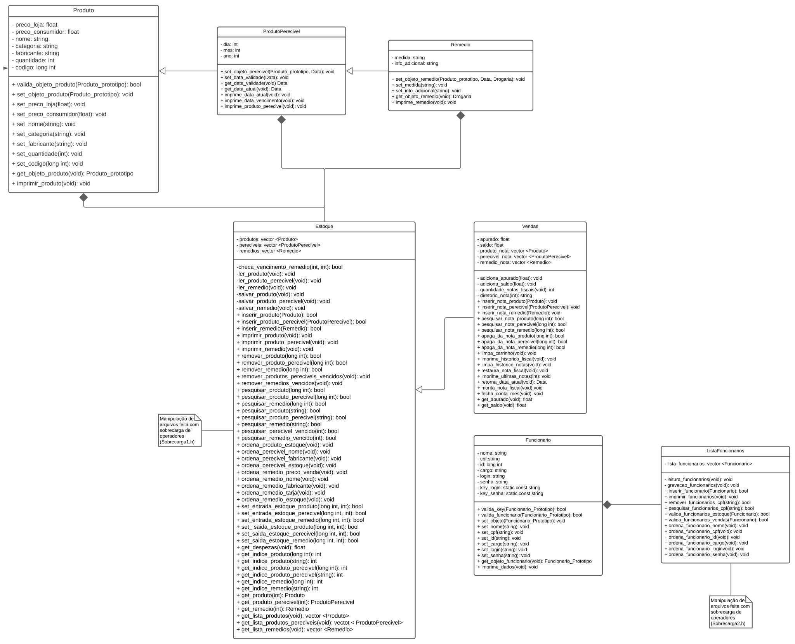
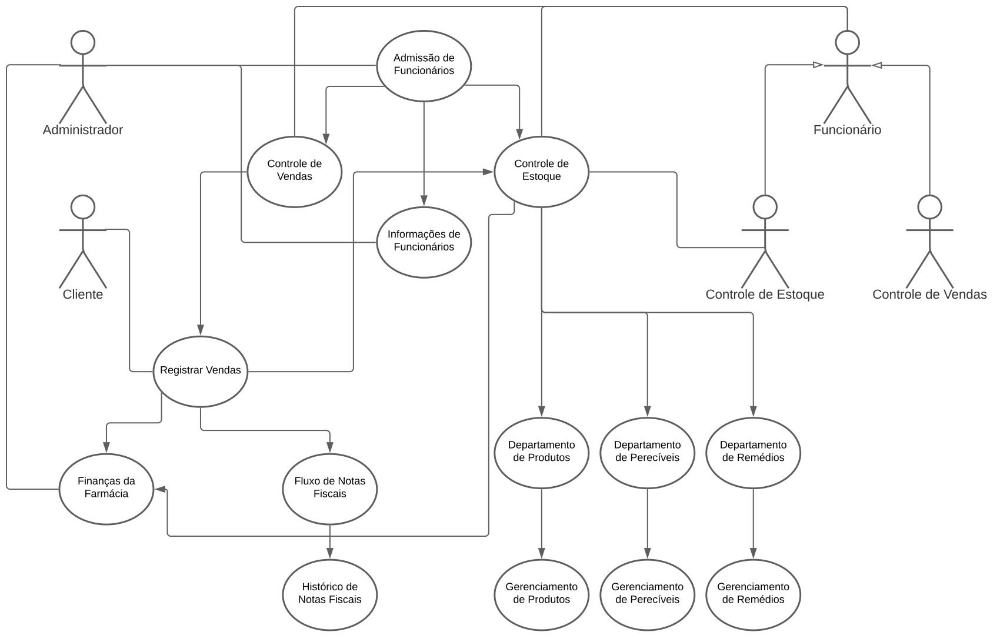

# Controle de Estoque e Vendas

Projeto de **controle de estoque e vendas para uma farmácia**, desenvolvido em **C++**, com foco em orientação a objetos, persistência em arquivos e organização modular do sistema.

## Objetivo

Implementar um sistema capaz de gerenciar o **estoque**, as **vendas** e o **controle de acesso de funcionários** de uma farmácia, utilizando os principais conceitos da linguagem C++ e boas práticas de programação.

## Diagramas

### Diagrama UML

> [Visualizar em alta resolução](https://github.com/Alyssonmach/controle-estoque-vendas/blob/v1.0.0/diagramacao/controle-estoque-vendas-farmacia.svg)

### Diagrama de Caso de Uso

> [Visualizar em alta resolução](https://github.com/Alyssonmach/controle-estoque-vendas/blob/v1.0.0/diagramacao/caso-de-uso-controle-estoque-vendas-farmacia.svg)

## Tecnologias e Conceitos Utilizados

* Versionamento completo do projeto utilizando **Git**;
* Desenvolvimento em **C++**, como trabalho final da disciplina *Técnicas de Programação* (UFCG — Engenharia Elétrica);
* Aplicação de **orientação a objetos**, incluindo herança, encapsulamento e polimorfismo;
* Utilização de **tratamento de exceções**, manipulação de arquivos e **alocação dinâmica** com `vector`;
* Modelagem do sistema por meio de **Diagramas UML** e **Diagramas de Casos de Uso**.

## Principais Classes Implementadas

### Sobrecarga1 e Sobrecarga2

Responsáveis pela **sobrecarga de operadores**, permitindo que a leitura e escrita de dados em arquivos seja realizada automaticamente nos **construtores e destrutores**. Dessa forma, as listas de objetos são carregadas no início da execução e persistidas ao final.

Essas implementações são utilizadas nas seguintes classes:

* Produto;
* ProdutoPerecivel;
* Remedio;
* Funcionario.

### Produto

Representa produtos **não perecíveis**, armazenando informações como nome, fabricante, categoria, código de barras, preço de aquisição, preço de venda e quantidade em estoque. Inclui métodos de configuração e exibição dos dados.

### ProdutoPerecivel

Especialização da classe `Produto`, adicionando o atributo **data de validade**. Possui métodos para verificar automaticamente se o produto encontra-se vencido.

### Remedio

Herda de `ProdutoPerecivel` e adiciona informações específicas de medicamentos, como **dosagem**, **unidade de medida** e **finalidade terapêutica**.

### Funcionario

Armazena os dados dos funcionários da farmácia, como nome, CPF, cargo, login e senha. Permite controle de acesso às áreas do sistema, divididas entre:

* Controle de Vendas;
* Controle de Estoque.

### Estoque

Responsável pelo **gerenciamento completo dos produtos** disponíveis para venda. Armazena objetos das classes `Produto`, `ProdutoPerecivel` e `Remedio` em estruturas `vector` e implementa métodos para:

* Leitura e gravação de dados em arquivos;
* Inserção, remoção, pesquisa e listagem de produtos;
* Verificação e remoção de produtos vencidos;
* Ordenação dos produtos por diferentes atributos;
* Atualização da quantidade em estoque;
* Cálculo da despesa total da farmácia com base no estoque atual.

### Vendas

Realiza a comunicação indireta com a classe `Estoque`. Permite:

* Registro de vendas;
* Emissão e gerenciamento de **notas fiscais**;
* Apuração do faturamento e despesas mensais;
* Estorno de produtos ao estoque;
* Consulta às últimas notas fiscais emitidas;
* Fechamento mensal das contas.

### ListaFuncionarios

Gerencia o cadastro e autenticação dos funcionários da farmácia. Herda da classe `Funcionario` e mantém listas em `vector`, permitindo:

* Cadastro de administradores, funcionários de vendas e funcionários de estoque;
* Validação de login e senha;
* Inserção, remoção e pesquisa de funcionários por CPF;
* Ordenação da lista de funcionários por diferentes atributos.

## Estrutura de Diretórios

### `arquivos/`

Contém os arquivos `.txt` responsáveis por armazenar os dados persistentes de produtos, produtos perecíveis e remédios.

### `notasfiscais/`

Armazena as notas fiscais geradas, separando as vendas atuais do histórico consolidado.

### `funcionarios/`

Contém os arquivos `.txt` relacionados ao cadastro e persistência dos funcionários.

### `cabecalhos/`

Arquivos de cabeçalho (`.h`) das classes do projeto.

### `implementacoes/`

Arquivos de implementação (`.cpp`) das classes do projeto.

### `testes/`

Arquivos de teste (`.cpp`) utilizados para validação do funcionamento dos métodos implementados.
